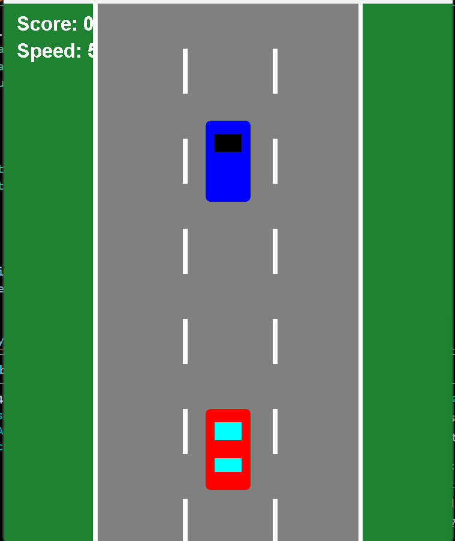

# 🏎️ Java Racing Game

An interactive 2D racing game developed using **Java Swing and AWT**, featuring real-time gameplay, collision detection, randomized obstacles, and progressive difficulty.
## Gameplay Preview

## Project Overview

This project is a desktop racing game built using Java to strengthen my understanding of object-oriented programming, graphical user interfaces (GUIs), and event-driven programming.

Players control a car while avoiding oncoming vehicles. As the player successfully avoids obstacles, their score increases and the game becomes progressively more challenging.

## Features

- **Player Controls:** Move the vehicle left and right using keyboard arrow keys.
- **Collision Detection:** Detect collisions between the player's car and incoming vehicles using Java's `Rectangle` class.
- **Dynamic Difficulty:** Increase game speed after every five successfully avoided vehicles.
- **Randomized Obstacles:** Generate enemy vehicles in one of three randomly selected lanes.
- **Score Tracking:** Track the player's score throughout gameplay.
- **Restart Functionality:** Restart the game by pressing `R` after a collision.
- **Animated Graphics:** Simulate road movement and vehicle motion using Java Swing.
- **Game Over Screen:** Display the final score and restart instructions.

## Technologies Used

- **Java** — Core programming language
- **Java Swing** — Desktop GUI and game rendering
- **Java AWT** — Graphics, keyboard events, and collision detection
- **Git & GitHub** — Version control and project hosting
- **Visual Studio Code** — Development environment

## How to Run

### Requirements
- Java Development Kit (JDK)
- Visual Studio Code or another Java-compatible development environment

### Instructions

1. Clone the repository or download the source code.
2. Open the project folder in Visual Studio Code.
3. Open a terminal in the folder containing `RacingGame.java`.
4. Compile the program:

   `javac RacingGame.java`

5. Run the game:

   `java RacingGame`

## Game Controls

| Key | Action |
|---|---|
| Left Arrow | Move car left |
| Right Arrow | Move car right |
| R | Restart after game over |

## Technical Implementation

**Game Loop:** Uses a Java Swing Timer with a 16-millisecond interval to update game elements, targeting approximately 60 frames per second.

**Collision Detection:** Uses rectangular bounding boxes and the `intersects()` method to detect vehicle collisions.

**Difficulty Scaling:** Increases the movement speed after every five successfully avoided enemy vehicles.

**Randomization:** Uses Java's `Random` class to select enemy vehicle spawn lanes.

**Rendering:** Overrides `paintComponent()` to draw the road, player vehicle, enemy vehicle, and game interface.

## Skills Demonstrated

- Object-Oriented Programming (OOP)
- Event-Driven Programming
- Graphical User Interface Development
- Collision Detection
- Game Logic and Animation
- Debugging and Problem-Solving
- Version Control

## Future Improvements

- Add multiple enemy vehicles
- Implement sound effects and background music
- Introduce a main menu and pause functionality
- Add high-score tracking
- Improve vehicle graphics and animations

## Developer

Developed as a personal Java programming project to gain hands-on experience with software development and interactive applications.
